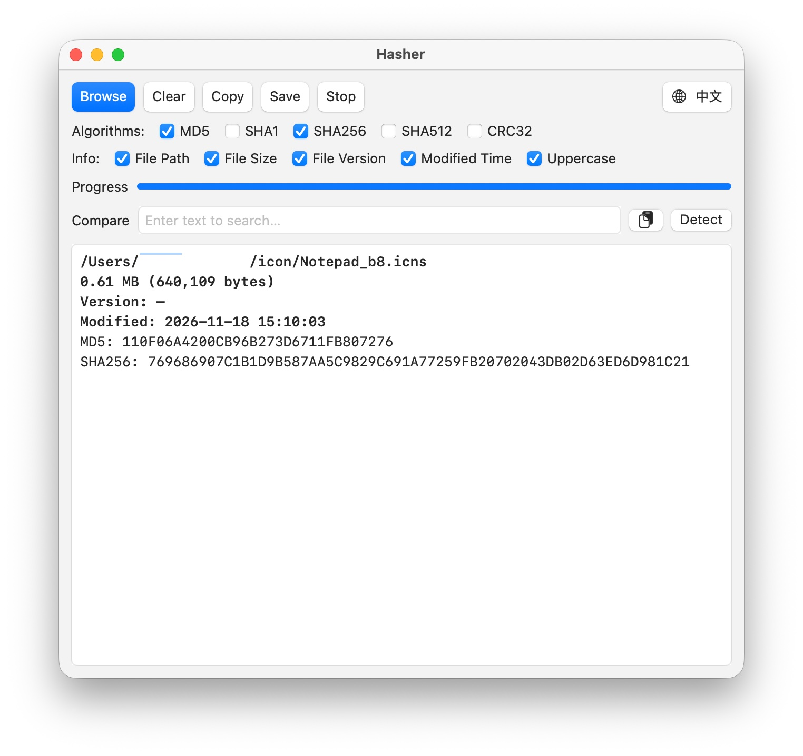

<p align="center"> English | <a href=./README.md>简体中文</a></p>
# Hasher — a macOS hash tool

A hash calculation tool for macOS written in Swift, supporting MD5, SHA1, SHA256, SHA512, and CRC32.
It reads the disk once to compute multiple algorithms simultaneously, uses multi-core parallel processing, and supports both Chinese and English interfaces.



## Features

- **Multiple algorithms**: MD5, SHA1, SHA256, SHA512, and CRC32, with MD5 and SHA256 checked by default
- **High performance**: reads the disk once to compute multiple algorithms at the same time; reads large files in 8 MB chunks; processes multiple files in parallel across multiple cores
- **Optional result details**: file path, file size (MB + thousands-separated bytes), file version, modification time, and uppercase results
- **Compare / detect**: search keywords within the results — matches turn the input box light blue, non-matches turn it pink
- **Drag & drop**: drop files or folders onto the results area to start hashing
- **Export**: copy to clipboard or save as a UTF-8 text file
- **Globalization**: displays Chinese or English according to the system language at launch; language files are stored separately for easy extension
- **Universal binary**: supports both Apple Silicon (arm64) and Intel (x86_64), requires macOS 15 or later

## Directory structure

```
hasher/
├── Package.swift                       # SPM project manifest
├── Sources/Hasher/
│   ├── HasherApp.swift                 # App entry point (SwiftUI @main)
│   ├── Localization.swift              # Localization helper
│   ├── Models/                         # Data model layer
│   │   ├── HashAlgorithm.swift         #   algorithm enum
│   │   └── FileHashResult.swift        #   result struct
│   ├── Services/                       # Business logic layer (UI-independent, reusable)
│   │   ├── Hasher.swift                #   MD5/SHA family hashers
│   │   ├── CRC32.swift                 #   CRC32 hasher (hand-implemented)
│   │   ├── HashPipeline.swift          #   multi-algorithm pipeline
│   │   ├── FileInfo.swift              #   file info utilities
│   │   └── HashEngine.swift            #   multi-core hashing engine
│   ├── UI/                             # UI layer (SwiftUI)
│   │   ├── ContentView.swift           #   main view
│   │   └── HasherViewModel.swift       #   view model (MVVM)
│   └── Resources/                      # language files (separate folder)
│       ├── zh-Hans.lproj/Localizable.strings
│       └── en.lproj/Localizable.strings
└── scripts/build-app.sh                # .app packaging script
```

## How to run (development / debugging)

Requires Xcode (which includes the Swift toolchain). Run this from the project root:

```bash
swift run Hasher
```

> Note: during development the interface language follows the system language; you can
> temporarily override it with the `-AppleLanguages` argument, e.g. to force Chinese:
> `swift run Hasher -AppleLanguages '(zh-Hans)'`

## How to package as a .app

```bash
./scripts/build-app.sh
```

The output is at `dist/Hasher.app`; double-click to run it, or use `open dist/Hasher.app`.
This script produces an arm64 + x86_64 universal binary.

## Adding a new language

Create a folder for the corresponding language under `Sources/Hasher/Resources/`, for example `ja.lproj`,
copy a `Localizable.strings` file into it, translate it, and you're done — no code changes required.
