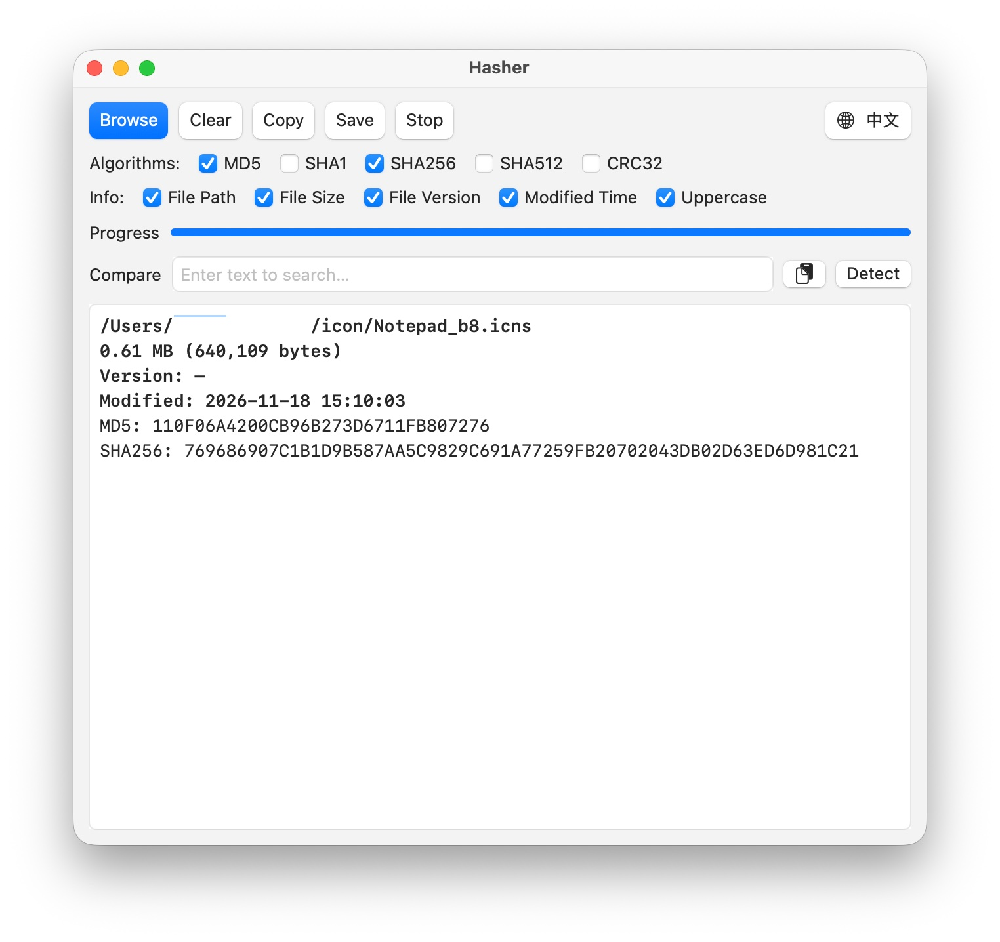

<p align="center"><a href=./README-en.md>English</a> | 简体中文</p>
# Hasher —— macOS 哈希计算小工具

一个用 Swift 编写的 macOS 哈希计算工具，支持 MD5、SHA1、SHA256、SHA512、CRC32，
可一次读取磁盘同时计算多个算法，多核并行处理，支持中英文界面。


## 功能特性

- **多算法**：MD5、SHA1、SHA256、SHA512、CRC32，默认勾选 MD5 和 SHA256
- **高性能**：一次读盘同时计算多个算法；8 MB 分块读取大文件；多核并行处理多个文件
- **结果信息可选**：文件路径、文件大小（MB + 千分位字节数）、文件版本、修改时间、结果大写
- **比较/检测**：在结果里搜索关键字，命中输入框变浅蓝，未命中变粉红
- **拖拽**：把文件或文件夹拖到结果区即可开始计算
- **导出**：复制到剪贴板、保存为 UTF-8 文本文件
- **全球化**：启动时按系统语言显示中文或英文；语言文件独立存放，便于扩展
- **通用二进制**：同时支持 Apple Silicon（arm64）和 Intel（x86_64），最低 macOS 15

## 目录结构

```
hasher/
├── Package.swift                       # SPM 工程清单
├── Sources/Hasher/
│   ├── HasherApp.swift                 # 程序入口（SwiftUI @main）
│   ├── Localization.swift              # 本地化辅助
│   ├── Models/                         # 数据模型层
│   │   ├── HashAlgorithm.swift         #   算法枚举
│   │   └── FileHashResult.swift        #   计算结果结构
│   ├── Services/                       # 业务逻辑层（与界面无关，可复用）
│   │   ├── Hasher.swift                #   MD5/SHA 系列哈希器
│   │   ├── CRC32.swift                 #   CRC32 哈希器（手动实现）
│   │   ├── HashPipeline.swift          #   多算法流水线
│   │   ├── FileInfo.swift              #   文件信息工具
│   │   └── HashEngine.swift            #   多核计算引擎
│   ├── UI/                             # 界面层（SwiftUI）
│   │   ├── ContentView.swift           #   主界面
│   │   └── HasherViewModel.swift       #   视图模型（MVVM）
│   └── Resources/                      # 语言文件（独立文件夹）
│       ├── zh-Hans.lproj/Localizable.strings
│       └── en.lproj/Localizable.strings
└── scripts/build-app.sh                # 打包 .app 脚本
```

## 如何运行（开发调试）

需要 Xcode（自带 Swift 工具链）。在项目根目录执行：

```bash
swift run Hasher
```

> 注意：开发调试时界面语言跟随系统语言；也可临时用
> `-AppleLanguages` 参数指定，例如强制中文：
> `swift run Hasher -AppleLanguages '(zh-Hans)'`

## 如何打包成 .app

```bash
./scripts/build-app.sh
```

产物在 `dist/Hasher.app`，双击即可运行，或 `open dist/Hasher.app`。
该脚本会生成 arm64 + x86_64 通用二进制。

## 扩展新语言

在 `Sources/Hasher/Resources/` 下新建对应语言的文件夹，例如 `ja.lproj`，
复制一份 `Localizable.strings` 翻译后即可，无需改动代码。
